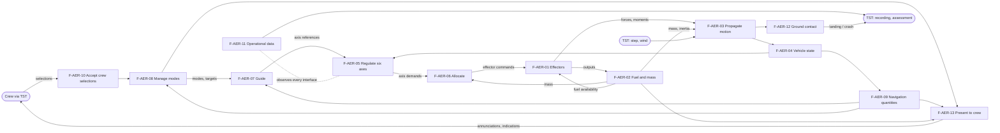
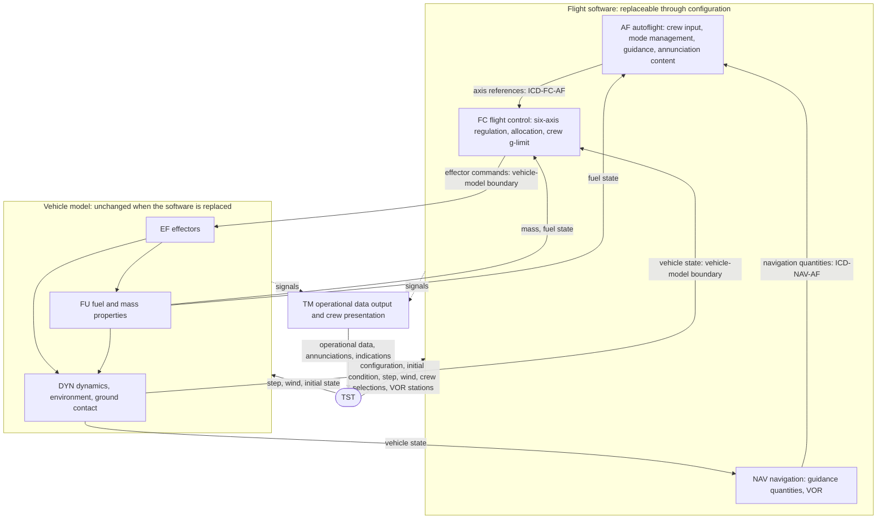

# Aeronef — Functional Analysis (L1)

**Status:** Draft (task B1), for Gate G1
**Date:** 2026-10-28
**Owner:** Martin
**Classification:** Protected design material. Not for release to the Reverse-Engineering Effort (RVS).
**Related:** [L0](../requirements/L0.md) (tag `L0-baseline-1`), [L1](../requirements/L1.md) (draft `work/B1/L1_AER.md`), [CONOPS](CONOPS.md), [CONVENTIONS](CONVENTIONS.md), [GLOSSARY](GLOSSARY.md), METHODOLOGY §5 and §7, plan §6 (B1) and §9 (D1–D44).

## 1. Purpose and scope

This document is the METHODOLOGY step 2 and step 4 work for the Aeronef element (AER) at L1. It gives:

1. the refined Aeronef function list (§2);
2. the N² interface matrix between functions and with the outside (§3);
3. the control-loop flow and its timing within one control frame (§4);
4. the logical architecture and the alternatives considered (§5);
5. the allocation of functions and of every L1 requirement to the L2 subsystems DYN, FU, EF, FC, AF, NAV, TM (§6);
6. the top-level budgets, with their splits (§7);
7. the L0 → L1 coverage table (§8).

**Rules applied.** The Aeronef is treated as a whole at L1. Modes, mode groups, combinations and mode logic are L2 (C5, D33): this document names the autoflight functions but does not define any mode. There is one control-law set and one Aeronef configuration (D42). Hazards are deferred (tailoring): failure inputs listed in METHODOLOGY §5 for F-AER-08 are dropped, and fuel exhaustion and effector saturation are nominal behaviour (L0-ASM-070). Values are parameters; proposals are in `work/B1/param_proposals.md`.

## 2. Function list

Functions are verbs. F-AER-01 to 08 are the METHODOLOGY §5 functions, refined. F-AER-09 to 14 are new: navigation (09), crew input (10), operational data (11), ground contact (12), crew presentation (13) and run set-up (14).

| ID | Function | Main inputs → outputs | Refinement relative to METHODOLOGY §5 | Subsystem |
| --- | --- | --- | --- | --- |
| F-AER-01 | Generate control forces and control moments with the effectors | Effector commands, fuel availability → effector outputs (body forces, body moments) | Adds fuel availability (zero output at fuel exhaustion, L0-CON-100) and the per-effector maximum force (L0-CON-300). | EF |
| F-AER-02 | Consume fuel and update mass properties | Effector outputs, initial fuel mass → fuel mass flow, remaining fuel mass, vehicle mass, inertia, fuel state | Separate translational and rotational consumption terms (L0-CON-120); centre of gravity fixed (L0-CON-130); fuel state for the crew alerts. | FU |
| F-AER-03 | Propagate six-degree-of-freedom rigid-body motion under control forces, gravity and drag | Effector outputs, mass, inertia, wind, simulation step → vehicle state | Drag on the air-relative velocity with wind (L0-CON-090, D17); standard-atmosphere density (D20); sensed acceleration computed for the crew limit (L0-CON-310). | DYN |
| F-AER-04 | Provide the vehicle state to the navigation and control functions | Vehicle state → vehicle state at the start of each control frame | Perfect knowledge (L0-ASM-010) is now a requirement (L1-AER-440), not a TBR. | DYN |
| F-AER-05 | Regulate each translational and rotational degree of freedom independently | Axis references, vehicle state, vehicle mass → axis demands | Six separate references; the attitude references keep pitch and roll level under autoflight (D10). | FC |
| F-AER-06 | Allocate axis demands to the effectors | Axis demands, effector limits, vehicle mass → effector commands | Keeps the sensed acceleration within the crew limit at each fuel state (L0-CON-310, D38); saturation is nominal behaviour. The priority rule is a derived requirement at L3/L4 (C4, FC1). | FC |
| F-AER-07 | Guide the vehicle according to the active autoflight modes | Mode state, targets, navigation quantities → axis references | Manoeuvres limited in acceleration (D16) within the vehicle acceleration budget (§7.2). The guidance laws are L2/L3. | AF |
| F-AER-08 | Manage autoflight mode selection, arming, engagement, transitions and annunciation content | Crew selections, navigation quantities, fuel state → mode state (armed and active modes), targets, annunciation content | Failure inputs removed (tailoring). Groups and combinations are L2 (Q5, #6; proposal in `work/B1/issues.md`). | AF |
| F-AER-09 | Compute the navigation quantities | Vehicle state, VOR station definitions, selected VOR station and course → altitude, horizontal speed, vertical speed, heading, track, flight path angle, radial, TO/FROM sense, course deviation, distance to station, validity | New. Ideal VOR (D12); definitions CV-430 to CV-670; validity thresholds CV-580. | NAV |
| F-AER-10 | Accept the crew selections | Crew interface input (crew-facing units) → selections and selected values converted to SI targets (CV-770) | New. The crew is a human through the TST, a test procedure or an RVS agent (L0-ASM-120). Inputs come through the flight control panel data (L0-CON-180); the panel layout is #79. | AF |
| F-AER-11 | Produce the operational data | Signals of each function, timestamps, configuration identity → time-stamped operational data | New. Relates crew inputs, mode changes, control activity and vehicle responses in time (L0-OBJ-140). The releasable/protected classification is deferred with the RVS (#69, G0-F22). | TM |
| F-AER-12 | Detect ground contact and classify it as a landing or a crash | Vehicle state, sensed acceleration → landing or crash event | New. Ideal landing (D37, L0-CON-290). The TST ends the run on the event. | DYN |
| F-AER-13 | Present the annunciations and indications to the crew | Mode state and targets, navigation quantities, fuel state → crew interface output (crew-facing units) | New. Crew-facing units and conversions per CV-740, CV-750, CV-760. | TM |
| F-AER-14 | Initialise and configure a run | Configuration (parameter set, flight-control-law design, autoflight implementation), initial condition → initial values of each function, configuration identity | New. Makes the control law and the autoflight implementation replaceable without touching the vehicle model (L0-CON-200, -210). | DYN, FU, FC, AF, NAV |

**Functions not on the list, on purpose.** Failure detection and reconfiguration (deferred); manual flight control (excluded by L0-CON-180; see `work/B1/issues.md` B1-Q09); sensor and state estimation (perfect knowledge, L0-ASM-010; a later upgrade, #83); electrical power (L0-CON-160).

## 3. N² interface matrix

### 3.1 Function level

Read a cell as "row produces, column consumes". Diagonal cells name the function. The interface IDs (I-nn) are listed in §3.2. "TST" includes the crew when the crew acts through the TST interface (L0-ASM-120).

| From \ To | F-01 | F-02 | F-03 | F-04 | F-05 | F-06 | F-07 | F-08 | F-09 | F-10 | F-11 | F-12 | F-13 | F-14 | TST |
| --- | --- | --- | --- | --- | --- | --- | --- | --- | --- | --- | --- | --- | --- | --- | --- |
| **F-01** | **EF out** | I-01 | I-02 | | | | | | | | I-30 | | | | |
| **F-02** | I-03 | **Fuel** | I-04 | | I-05 | I-05 | | I-06 | | | I-31 | | I-06 | | |
| **F-03** | | | **Motion** | I-07 | | | | | | | I-32 | I-08 | | | |
| **F-04** | | | | **State** | I-09 | I-09 | | | I-10 | | | | | | |
| **F-05** | | | | | **Regulate** | I-11 | | | | | I-33 | | | | |
| **F-06** | I-12 | | | | | **Allocate** | | | | | I-33 | | | | |
| **F-07** | | | | | I-13 | | **Guide** | | | | I-34 | | | | |
| **F-08** | | | | | | | I-14 | **Modes** | I-15 | | I-34 | | I-16 | | |
| **F-09** | | | | | | | I-17 | I-17 | **Nav** | | I-35 | | I-18 | | |
| **F-10** | | | | | | | | I-19 | I-20 | **Crew in** | I-36 | | | | |
| **F-11** | | | | | | | | | | | **Op data** | | | | I-40 |
| **F-12** | | | | | | | | | | | I-37 | **Contact** | | | I-41 |
| **F-13** | | | | | | | | | | | I-38 | | | **Present** | I-42 |
| **F-14** | I-21 | I-21 | I-21 | | I-22 | I-22 | | I-23 | I-24 | | I-39 | | | **Set-up** | |
| **TST** | | | I-25 | | | | | | | I-26 | | | | I-27 | **—** |

Each function has at least one input and one output, and every output has a consumer, so there is no dangling function. TM (F-11) consumes from every function but feeds nothing back: it is an observer (§5).

### 3.2 Interface list

| ID | From → To | Data | ICD (proposed home) |
| --- | --- | --- | --- |
| I-01 | F-01 → F-02 | Effector outputs (for consumption) | Vehicle-model boundary (internal to the model; MS-DYN) |
| I-02 | F-01 → F-03 | Control forces and control moments in the body frame | MS-DYN |
| I-03 | F-02 → F-01 | Fuel availability (remaining fuel mass above zero) | MS-DYN |
| I-04 | F-02 → F-03 | Vehicle mass, inertia tensor, centre-of-gravity position | MS-DYN |
| I-05 | F-02 → F-05, F-06 | Current vehicle mass (crew acceleration limit, force scaling) | Vehicle-model boundary (new; `work/B1/interface_needs.md` IN-B1-01) |
| I-06 | F-02 → F-08, F-13 | Remaining fuel mass, low-fuel and fuel-exhaustion states | Vehicle-model boundary; ICD-AER-TST (crew output) |
| I-07 | F-03 → F-04 | Vehicle state: position, velocity, attitude quaternion, body rates, vehicle acceleration, sensed acceleration | MS-DYN |
| I-08 | F-03 → F-12 | Altitude, velocity, sensed acceleration at contact | MS-DYN |
| I-09 | F-04 → F-05, F-06 | Vehicle state at the start of the control frame | Vehicle-model boundary |
| I-10 | F-04 → F-09 | Vehicle state at the start of the control frame | Vehicle-model boundary |
| I-11 | F-05 → F-06 | Axis demands: three force demands and three moment demands | Internal to FC (L3, C4) |
| I-12 | F-06 → F-01 | Effector commands | Vehicle-model boundary |
| I-13 | F-07 → F-05 | Axis references for the six degrees of freedom | ICD-FC-AF |
| I-14 | F-08 → F-07 | Active and armed modes, targets | Internal to AF (C5) |
| I-15 | F-08 → F-09 | Selected VOR station and selected course | ICD-NAV-AF |
| I-16 | F-08 → F-13 | Annunciation content: armed and active modes, targets | Internal to the Aeronef (AF → TM; ICD-AER-TST for the output) |
| I-17 | F-09 → F-07, F-08 | Navigation quantities and their validity | ICD-NAV-AF |
| I-18 | F-09 → F-13 | Navigation quantities for the indications | ICD-AER-TST (crew output) |
| I-19 | F-10 → F-08 | Mode selections, targets in SI | Internal to AF |
| I-20 | F-10 → F-09 | Selected VOR station and selected course (if routed directly) | ICD-NAV-AF |
| I-21 | F-14 → F-01, F-02, F-03 | Initial state, initial fuel mass, vehicle parameter set | ICD-AER-TST |
| I-22 | F-14 → F-05, F-06 | Flight-control-law design selection | ICD-AER-TST |
| I-23 | F-14 → F-08 | Initial mode state and targets | ICD-AER-TST |
| I-24 | F-14 → F-09 | VOR station definitions | ICD-AER-TST |
| I-25 | TST → F-03 | Simulation step command, wind velocity | ICD-AER-TST |
| I-26 | TST → F-10 | Crew selections with their timestamps | ICD-AER-TST (crew interface) |
| I-27 | TST → F-14 | Configuration and initial condition | ICD-AER-TST |
| I-30 to I-39 | F-01 … F-14 → F-11 | Signals recorded in the operational data (L1-AER-610 to -640) | ICD-AER-TST (operational data) |
| I-40 | F-11 → TST | Operational data, one record per output sample | ICD-AER-TST |
| I-41 | F-12 → TST | Landing or crash event (the TST ends the run) | ICD-AER-TST |
| I-42 | F-13 → TST | Annunciations and indications in crew-facing units | ICD-AER-TST (crew interface) |

### 3.3 Subsystem level

Same convention, after allocation (§6). "×" marks an interface that crosses a subsystem boundary.

| From \ To | DYN | FU | EF | FC | AF | NAV | TM | TST |
| --- | --- | --- | --- | --- | --- | --- | --- | --- |
| **DYN** | — | | | × state | | × state | × state, events | × events |
| **FU** | × mass, inertia | — | × fuel availability | × mass | × fuel state | | × fuel state | |
| **EF** | × forces, moments | × outputs | — | | | | × outputs | |
| **FC** | | | × effector commands | — | | | × refs, demands, commands | |
| **AF** | | | | × axis references | — | × station, course | × modes, targets, annunciation content | |
| **NAV** | | | | | × navigation quantities | — | × indications | |
| **TM** | | | | | | | — | × operational data, crew output |
| **TST** | × step, wind, initial state | × initial fuel | | × control-law selection | × crew selections, initial modes | × VOR stations | | — |

## 4. Control-loop flow

### 4.1 Loop

One feedback path closes through the vehicle physics. Autoflight sits outside the flight-control loop and changes only its references (D15). TM observes and feeds nothing back.

### 4.2 Sequence within one control frame

The vehicle model advances in simulation steps of `[P-SYS-300]`; the flight software (NAV, AF, FC) runs once per control frame of `[P-SYS-310]`, an integer multiple of the step (L1-AER-680, DD-010 proposed). Whether an input timestamped k first affects step k or k + 1 is fixed in ICD-AER-TST (CV-840).

| Order | Function | Uses | Produces |
| --- | --- | --- | --- |
| 1 | F-AER-04 | Vehicle state at step k (frame start) | State for NAV and FC |
| 2 | F-AER-10 | Crew selections timestamped up to step k | SI targets and selections |
| 3 | F-AER-09 | State at step k, selected station and course | Navigation quantities |
| 4 | F-AER-08 | Selections, navigation quantities, fuel state | Mode state, targets |
| 5 | F-AER-07 | Mode state, targets, navigation quantities | Axis references |
| 6 | F-AER-05, F-AER-06 | References, state, mass | Effector commands, held for the frame |
| 7 | F-AER-01, -02, -03, -12 | Commands, per simulation step, for each step of the frame | State at each step; fuel; events |
| 8 | F-AER-11, F-AER-13 | Signals at each output sample `[P-TM-010]` | Operational data; crew output |

## 5. Logical architecture

### 5.1 Choice

**Chosen: a three-layer cascade (autoflight guidance → flight-control regulation and allocation → effectors) around a vehicle model (DYN, FU, EF) that sits behind one fixed boundary. NAV derives every guidance quantity from the true state, and TM observes every interface without feeding back.**

Boundaries the architecture fixes (each is an L1 interface requirement):

| Boundary | Crosses | L1 requirement | ICD |
| --- | --- | --- | --- |
| Vehicle-model boundary | Effector commands in; vehicle state, mass and fuel state out | L1-AER-430, -440 | New: proposed as a section of ICD-AER-TST or `icd/ICD-VM-FS.md` (IN-B1-01) |
| Autoflight → flight control | Axis references, the same for any law (D15) | L1-AER-420 | ICD-FC-AF |
| Navigation → autoflight | Navigation quantities and validity | L1-AER-530, -540 | ICD-NAV-AF |
| Aeronef ↔ TST | Configuration, initial condition, step, wind, VOR stations, crew interface, operational data, events | L1-AER-480, -490, -550, -590 to -670 | ICD-AER-TST |

### 5.2 Why

1. **Replaceable control laws and autoflight (L0-CON-200, -210, D15).** The two software layers meet the vehicle model only at the vehicle-model boundary, and meet each other only at ICD-FC-AF. Any autoflight implementation pairs with any control-law design, and neither change touches the vehicle model files.
2. **Independent degrees of freedom (L0-CON-020, -030, D18).** FC regulates six separate references; AF sets them. Because the axes are uncoupled, AF can set heading and track, pitch and flight path angle, independently.
3. **One definition of each navigation quantity.** AF, the crew indications and TM read the same NAV outputs, defined once by CV-430 to CV-670. A later sensor model (#83) replaces only the NAV input.
4. **Observability without interference.** TM taps every interface and feeds nothing back, so the operational data (L0-OBJ-140) cannot change the behaviour it records.
5. **Physics stays physics.** Fuel exhaustion, saturation and the crew g-limit are handled in the layer that owns them (EF, FC), not as mode logic.

### 5.3 Alternatives considered

| Alternative | Why not chosen |
| --- | --- |
| Integrated guidance and control: AF commands the effectors directly | Breaks D15 (modes decoupled from controllers) and L0-CON-200: replacing the control law would mean replacing the autoflight. |
| NAV inside AF | The crew indications and TM need the same quantities; a separate NAV avoids two definitions and isolates a future sensor model (#83). |
| FC reads navigation quantities instead of the vehicle state | FC regulates body rates and velocity components that NAV does not need to publish; going through NAV would add a dependency without benefit. Kept open for C4 if a sensor model is added. |
| A separate flight control panel subsystem (FCP, #80.3) | Not chosen in this draft, to keep the seven planned subsystems: crew input sits in AF (F-AER-10) and crew presentation in TM (F-AER-13). Option for the owner: `work/B1/issues.md` B1-Q01. If the owner adds an FCP, L1-AER-480, -500 (selection side) move to FCP, and L1-AER-490, -500 (presentation side), -560 to -580 split between FCP and TM. |
| TM as the crew-presentation owner versus AF | AF owns the annunciation content (which modes, which targets); TM owns the conversion to crew units and the output format. This keeps unit conversion in one place (CV-760). |

## 6. Allocation

### 6.1 Functions to subsystems

| Subsystem | Functions | Owns |
| --- | --- | --- |
| DYN — dynamics model | F-AER-03, F-AER-04, F-AER-12, part of F-AER-14 | Equations of motion, gravity, drag, wind, sensed acceleration, ground contact, simulation step, vehicle state, MS-DYN (C1) |
| FU — fuel and mass properties | F-AER-02, part of F-AER-14 | Fuel mass flow, remaining fuel, vehicle mass, inertia, fixed centre of gravity, fuel state for the alerts |
| EF — effectors | F-AER-01 | Effector outputs, directions, limits, command response, zero output at fuel exhaustion |
| FC — flight control | F-AER-05, F-AER-06, part of F-AER-14 | Six-axis regulation, allocation, crew g-limit as a force limit at the current mass, saturation behaviour |
| AF — autoflight | F-AER-07, F-AER-08, F-AER-10, part of F-AER-14 | Crew selection intake, mode logic, guidance, manoeuvre acceleration limit, annunciation content |
| NAV — navigation | F-AER-09, part of F-AER-14 | Guidance quantities and their validity, VOR quantities |
| TM — operational data output | F-AER-11, F-AER-13 | Time-stamped operational data, crew presentation in crew units, configuration identity, events |

Every function is allocated, and every subsystem has at least one function. F-AER-14 (run set-up) is shared: each subsystem initialises its own state from the initial condition and configuration (L1-AER-660, -400, -410).

### 6.2 L1 requirements to L2 subsystems

● = allocated. A record with no ● is a leaf at L1 (`Allocated to: —`), verified directly by its own method; these are the cross-cutting constraints and the documentation records. Each allocated record must get at least one child in each subsystem marked, at G2.

| L1 ID | Type | Requirement (short) | Parent(s) | DYN | FU | EF | FC | AF | NAV | TM |
| --- | --- | --- | --- | --- | --- | --- | --- | --- | --- | --- |
| L1-AER-010 | Model fidelity | compute its motion as a rigid body with six degrees of freedom in accordance wit… | L0-OBJ-010, L0-CON-010 | ● |  |  |  |  |  |  |
| L1-AER-020 | Constraint | exclude from its dynamics each term by which motion along one degree of freedom… | L0-CON-030 | ● |  | ● |  |  |  |  |
| L1-AER-030 | Constraint | produce no aerodynamic lift force. | L0-CON-040 | ● |  |  |  |  |  |  |
| L1-AER-040 | Constraint | have no aerodynamic control surface. | L0-CON-050 | ● |  | ● |  |  |  |  |
| L1-AER-050 | Model fidelity | compute the total force and moment on the vehicle as the sum of gravity, aerodyn… | L0-CON-090, L0-CON-060 | ● |  |  |  |  |  |  |
| L1-AER-060 | Model fidelity | apply a uniform gravitational acceleration of magnitude [P-DYN-010] along the do… | L0-CON-090 | ● |  |  |  |  |  |  |
| L1-AER-070 | Model fidelity | compute aerodynamic drag from its air-relative velocity and from the air density… | L0-CON-090 | ● |  |  |  |  |  |  |
| L1-AER-080 | Constraint | generate each control force and each control moment with its effectors. | L0-CON-060 |  |  | ● |  |  |  |  |
| L1-AER-090 | Constraint | keep the direction of action of each effector constant in the body frame. | L0-CON-070 |  |  | ● |  |  |  |  |
| L1-AER-100 | Constraint | define each effector only by its direction of action, its control effectiveness,… | L0-CON-080 |  | ● | ● |  |  |  |  |
| L1-AER-110 | Constraint | limit the force of each effector to the maximum force magnitude that the paramet… | L0-CON-300 |  |  | ● | ● |  |  |  |
| L1-AER-120 | Performance | be able to produce a control force of at least [P-SYS-400] along the negative bo… | L0-CON-020 |  |  | ● | ● |  |  |  |
| L1-AER-130 | Performance | be able to produce a control force of at least [P-SYS-410] along each of the pos… | L0-CON-020 |  |  | ● | ● |  |  |  |
| L1-AER-140 | Performance | be able to produce a control moment of at least [P-SYS-420] about each body axis… | L0-CON-020 |  |  | ● | ● |  |  |  |
| L1-AER-150 | Constraint | start each run with the fuel mass of its initial condition, of at most [P-FU-010… | L0-CON-100 |  | ● |  |  |  |  |  |
| L1-AER-160 | Model fidelity | compute its fuel mass flow from the control forces and control moments its effec… | L0-CON-120, L0-CON-100 |  | ● | ● |  |  |  |  |
| L1-AER-170 | Constraint | take its translational consumption parameters [P-FU-040] and its rotational cons… | L0-CON-120 |  | ● |  |  |  |  |  |
| L1-AER-180 | Model fidelity | compute its vehicle mass as its dry mass [P-FU-030] plus its remaining fuel mass… | L0-CON-110 | ● | ● |  |  |  |  |  |
| L1-AER-190 | Model fidelity | keep its remaining fuel mass within [P-FU-060] of its initial fuel mass minus th… | L0-CON-110 |  | ● |  |  |  |  |  |
| L1-AER-200 | Functional | produce zero control force and zero control moment. | L0-CON-100 |  | ● | ● |  |  |  |  |
| L1-AER-210 | Constraint | keep its centre of gravity at one fixed position in the body frame at each fuel… | L0-CON-130 | ● | ● |  |  |  |  |  |
| L1-AER-220 | Model fidelity | derive its inertia tensor at each fuel state from the elongated body shape and t… | L0-CON-140 | ● | ● |  |  |  |  |  |
| L1-AER-230 | Constraint | have no electrical power generation, distribution or consumption function. | L0-CON-160 | ● | ● | ● |  |  |  |  |
| L1-AER-240 | Constraint | have its nose on the positive body x axis. | L0-CON-150 | ● |  |  |  |  |  |  |
| L1-AER-250 | Constraint | have its crew station at the body-frame position [P-DYN-400]. | L0-CON-150 | ● |  |  |  |  |  |  |
| L1-AER-260 | Functional | report a landing in its operational data. | L0-CON-290 | ● |  |  |  |  |  | ● |
| L1-AER-270 | Functional | report a crash in its operational data. | L0-CON-290 | ● |  |  |  |  |  | ● |
| L1-AER-280 | Performance | classify a ground contact as within the landing envelope when the vertical speed… | L0-CON-290, L0-CON-310 | ● |  |  |  |  |  |  |
| L1-AER-290 | Performance | keep the magnitude of the sensed acceleration at the centre of gravity at most [P-SYS… | L0-CON-310 | ● | ● |  | ● | ● |  |  |
| L1-AER-300 | Performance | keep the magnitude of its vehicle acceleration at most [P-SYS-440]. | L0-CON-310 |  |  |  | ● | ● |  |  |
| L1-AER-310 | Performance | sustain a horizontal speed of [P-SYS-230] under autoflight. | L0-OBJ-030 |  |  | ● | ● | ● |  |  |
| L1-AER-320 | Performance | sustain a vertical speed of [P-SYS-240] under autoflight. | L0-OBJ-030 |  |  | ● | ● | ● |  |  |
| L1-AER-330 | Performance | sustain a vertical speed magnitude of [P-SYS-250] under autoflight. | L0-OBJ-030 |  |  | ● | ● | ● |  |  |
| L1-AER-340 | Performance | sustain a flight path angle of magnitude [P-SYS-260] under autoflight. | L0-OBJ-030 |  |  |  | ● | ● | ● |  |
| L1-AER-350 | Performance | sustain a heading rate of [P-SYS-270] under autoflight. | L0-OBJ-030 |  |  | ● | ● | ● |  |  |
| L1-AER-360 | Performance | from an initial fuel mass of [P-FU-010], stay airborne with fuel remaining for a… | L0-CON-100, L0-OBJ-030 |  | ● | ● |  |  |  |  |
| L1-AER-370 | Functional | regulate each of its six degrees of freedom toward a separate reference for that… | L0-OBJ-020, L0-CON-020 |  |  |  | ● |  |  |  |
| L1-AER-380 | Performance | keep the velocity along each other translational axis within [P-SYS-540] of its… | L0-CON-020, L0-OBJ-020 |  |  | ● | ● |  |  |  |
| L1-AER-390 | Performance | hold its pitch angle and its roll angle within [P-AF-180] of zero. | L0-OBJ-030, L0-CON-020 |  |  |  | ● | ● |  |  |
| L1-AER-400 | Constraint | take its flight-control-law design from its configuration, so that replacing the… | L0-CON-200 |  |  |  | ● |  |  |  |
| L1-AER-410 | Constraint | take its autoflight implementation from its configuration, so that replacing the… | L0-CON-210 |  |  |  |  | ● |  |  |
| L1-AER-420 | Interface | pass the axis references and mode status from autoflight to flight control throu… | L0-CON-200, L0-CON-210 |  |  |  | ● | ● |  |  |
| L1-AER-430 | Interface | exchange data between its vehicle model and its flight software only as effector… | L0-CON-200, L0-CON-210 | ● | ● | ● | ● |  |  |  |
| L1-AER-440 | Interface | provide its navigation and flight-control functions with the exact simulated veh… | L0-OBJ-020, L0-OBJ-030 | ● |  |  | ● |  | ● |  |
| L1-AER-450 | Functional | guide its translation and its heading toward the targets the crew selects, throu… | L0-OBJ-030 |  |  |  | ● | ● | ● |  |
| L1-AER-460 | Performance | keep its position within [P-SYS-450] of the reference position at each output sa… | L0-OBJ-030, L0-OBJ-020 |  |  | ● | ● | ● |  |  |
| L1-AER-470 | Performance | or when a target changes, annunciate the new mode state or target to the crew wi… | L0-OBJ-030, L0-CON-170 |  |  |  |  | ● |  | ● |
| L1-AER-480 | Interface | accept each crew selection of a mode or a target as a time-stamped data item of… | L0-CON-170, L0-OBJ-030 |  |  |  |  | ● |  |  |
| L1-AER-490 | Interface | output its annunciations and indications as data items of the crew interface def… | L0-CON-170 |  |  |  |  |  |  | ● |
| L1-AER-500 | Constraint | state each crew selection and each annunciated or indicated quantity in the crew… | L0-CON-270 |  |  |  |  | ● |  | ● |
| L1-AER-510 | Constraint | define no physical control device and no display format for its crew interface. | L0-CON-170 |  |  |  |  |  |  |  |
| L1-AER-520 | Constraint | take each crew input through the flight control panel data of its crew interface… | L0-CON-180 |  |  |  |  |  |  |  |
| L1-AER-530 | Functional | compute, at each control frame, its altitude, horizontal speed, vertical speed,… | L0-OBJ-030 |  |  |  |  |  | ● |  |
| L1-AER-540 | Functional | compute its radial from that station, the TO/FROM sense, the course deviation fr… | L0-OBJ-030 |  |  |  |  |  | ● |  |
| L1-AER-550 | Interface | accept from the TST, at the start of each run, the identifier and the position i… | L0-OBJ-030 |  |  |  |  |  | ● |  |
| L1-AER-560 | Functional | indicate its remaining fuel mass to the crew at each output sample. | L0-CON-100, L0-CON-170 |  | ● |  |  |  |  | ● |
| L1-AER-570 | Functional | annunciate a low-fuel alert within [P-SYS-470]. | L0-CON-100, L0-CON-170 |  | ● |  |  |  |  | ● |
| L1-AER-580 | Functional | annunciate fuel exhaustion within [P-SYS-470]. | L0-CON-100, L0-CON-170 |  | ● |  |  |  |  | ● |
| L1-AER-590 | Interface | attach to each output sample, crew selection record and event record the timesta… | L0-OBJ-140 |  |  |  |  |  |  | ● |
| L1-AER-600 | Performance | produce one operational data output sample every [P-TM-010] of simulation time. | L0-OBJ-140 |  |  |  |  |  |  | ● |
| L1-AER-610 | Functional | record in its operational data each crew selection it receives and each target t… | L0-OBJ-140 |  |  |  |  | ● |  | ● |
| L1-AER-620 | Functional | record in its operational data, at each output sample, the armed and active auto… | L0-OBJ-140 |  |  |  |  | ● |  | ● |
| L1-AER-630 | Functional | record in its operational data, at each output sample, the axis references, the… | L0-OBJ-140 |  | ● | ● | ● |  |  | ● |
| L1-AER-640 | Functional | record in its operational data, at each output sample, its vehicle state, its na… | L0-OBJ-140 | ● | ● |  |  |  | ● | ● |
| L1-AER-650 | Interface | output, for each run, the identifier and version of its vehicle parameter set, i… | L0-CON-200, L0-CON-210, L0-SUC-020 |  |  |  |  |  |  | ● |
| L1-AER-660 | Interface | accept from the TST, at the start of each run, an initial condition of position,… | L0-OBJ-010, L0-OBJ-030 | ● | ● |  |  | ● |  |  |
| L1-AER-670 | Interface | advance its vehicle model by one simulation step of [P-SYS-300] each time the ST… | L0-OBJ-010 | ● |  |  |  |  |  |  |
| L1-AER-680 | Performance | execute its navigation, autoflight and flight-control functions at a control fra… | Derived (DD-010) |  |  |  | ● | ● | ● |  |
| L1-AER-690 | Constraint | produce identical operational data from an identical configuration, initial cond… | L0-OBJ-110 | ● | ● | ● | ● | ● | ● | ● |
| L1-AER-700 | Constraint | execute each of its functions without a graphical display. | L0-CON-190 |  |  |  |  |  |  |  |
| L1-AER-710 | Performance | change its effector outputs in response to a vehicle state within [P-SYS-480] of… | Derived (DD-020) |  |  | ● | ● |  |  |  |
| L1-AER-720 | Documentation | have a baselined model specification, MS-DYN, that states its equations of motio… | L0-OBJ-010 | ● | ● | ● |  |  |  |  |
| L1-AER-730 | Constraint | state in SI units each quantity of its requirements, models, interface signals a… | L0-CON-260 |  |  |  |  |  |  |  |
| L1-AER-740 | Constraint | use the frames, axes, sign conventions and quantity definitions of the conventio… | L0-CON-280 |  |  |  |  |  |  |  |
| L1-AER-750 | Documentation | have its requirements in one level file per level, with each requirement below L… | L0-OBJ-180 |  |  |  |  |  |  |  |
| L1-AER-760 | Documentation | link each of its requirements to a verification method, a verification procedure… | L0-OBJ-190 |  |  |  |  |  |  |  |
| L1-AER-770 | Documentation | have each of its requirements whose verification method is Test verified by an a… | L0-SUC-030 |  |  |  |  |  |  |  |
| L1-AER-780 | Documentation | have each of its engineering artifacts peer reviewed before the artifact is base… | L0-OBJ-200 |  |  |  |  |  |  |  |
| L1-AER-790 | Documentation | The Aeronef configuration shall pass the verification of each baselined Aeronef… | L0-SUC-020 |  |  |  |  |  |  |  |
| L1-AER-800 | Documentation | have its requirements baselined down to the last requirement layer of each subsy… | L0-SUC-010 |  |  |  |  |  |  |  |
| L1-AER-810 | Documentation | pass the automated trace check at the requirements baseline with no orphan requi… | L0-SUC-150 |  |  |  |  |  |  |  |
| L1-AER-820 | Documentation | contribute to the final test report the last result of each verification procedu… | L0-SUC-170 |  |  |  |  |  |  |  |
| L1-AER-830 | Documentation | contribute to the method assessment report one section that assesses the AI-assi… | L0-OBJ-210 |  |  |  |  |  |  |  |
| L1-AER-840 | Documentation | have a Vehicle Operating Manual, normal procedures and quick reference checklist… | L0-OBJ-150 |  |  |  |  |  |  |  |

| Subsystem | DYN | FU | EF | FC | AF | NAV | TM | Leaf at L1 (—) |
| --- | --- | --- | --- | --- | --- | --- | --- | --- |
| L1 records allocated | 24 | 21 | 24 | 24 | 20 | 9 | 16 | 15 |

## 7. Budgets

Each budget is a top-level parameter set at L1, split between the L2 subsystems. The split is recorded here and in the rationale of the L1 record named. Values are TBD or TBR proposals (`work/B1/param_proposals.md`); the closure check is task I1 (plan §6, Phase 3b). Notation: m_max = [P-FU-030] + [P-FU-010] (maximum vehicle mass), m_dry = [P-FU-030], g = [P-DYN-010], D(V) = drag at airspeed V, J_max = largest moment of inertia.

### 7.1 Effector authority (L1-AER-120, -130, -140)

| Parameter | Must be at least | Contributors and owner |
| --- | --- | --- |
| P-SYS-400: control force along the negative body z axis (up at level attitude) | m_max · (g + [P-SYS-440]) + D([P-SYS-240]) | Weight at maximum mass (FU, DYN); manoeuvre share (AF, FC); drag in the fastest climb (DYN). There is no vertical wind (L0-ASM-050, D51). |
| P-SYS-410: control force along each other body direction | m_max · [P-SYS-440] + D([P-SYS-230] + [P-SYS-430] + [P-SYS-560]) | Manoeuvre share; drag at maximum horizontal speed into the largest instantaneous wind, steady plus gust (D51). |
| P-SYS-420: control moment about each body axis | J_max · α_req + drag moment + level-attitude holding margin | α_req is the angular acceleration needed to reach [P-SYS-270] within the heading-rate onset time that C4 sets. |

Upper side of the budget: the crew limit caps the usable resultant control force at the current mass times [P-SYS-120], minus drag (L1-AER-290). At low fuel the effectors can produce more than the crew may feel, so FC limits the force; this is nominal behaviour, not saturation. EF sizes the effector set and its per-effector maxima (L1-AER-110) so that the three pure forces and moments exist with the other components at zero (L0-CON-020).

### 7.2 Crew acceleration and vehicle acceleration (L1-AER-290, -300)

The sensed acceleration is the vehicle acceleration minus the gravity vector, so its magnitude is at most |vehicle acceleration| + g. It is evaluated at the centre of gravity (D45, #97), so rotation adds nothing.

| Share | Parameter | Owner | Proposed (TBR) |
| --- | --- | --- | --- |
| Holding the vehicle up against gravity | [P-DYN-010] | DYN | 1 g (9.806 65 m/s²) |
| Vehicle acceleration, aircraft level | [P-SYS-440] | AF, FC | 1.5 g |
| — of which autoflight manoeuvre limit (D16) | [P-AF-200] | AF | 1.0 g |
| — of which flight-control transient allowance | [P-FC-020] | FC | 0.5 g |
| Margin | — | — | 0.5 g |
| **Total, at most** | **[P-SYS-120]** | | **3 g** (confirmed by the owner, D45) |

Closure rule: [P-DYN-010] + [P-SYS-440] ≤ [P-SYS-120], and [P-AF-200] + [P-FC-020] ≤ [P-SYS-440]. The landing-envelope limit [P-SYS-520] ≤ [P-SYS-120] (L1-AER-280).

### 7.3 Fuel (L1-AER-150, -160, -360)

| Item | Parameter | Rule |
| --- | --- | --- |
| Usable fuel at full capacity | [P-FU-010] | Sized so that the hover endurance holds at maximum mass. |
| Hover endurance at full fuel | [P-SYS-280] | Holding a fixed position, no wind: the effectors only counter gravity. |
| Dry mass | [P-FU-030] | m_dry. |
| Translational and rotational consumption | [P-FU-040], [P-FU-050] | Form in MS-DYN (C2). |
| Low-fuel threshold | [P-FU-020] | A crew alert, not a reserve. |

With a translational consumption proportional to force (coefficient k_t = [P-FU-040], kg per N·s) and no rotation, the mass obeys dm/dt = −k_t·g·m in a hover, so the endurance from full fuel is ln(m_max / m_dry) / (k_t·g). The budget is therefore [P-FU-010] ≥ m_dry · (exp(k_t · g · [P-SYS-280]) − 1). C2 confirms the form and adds the attitude-holding consumption. The reference mission (SC-110) is sized by its scenario variables so that fuel remains at the start of its last leg (D32); it is not a parameter budget.

### 7.4 Position error (L1-AER-460)

| Share | Parameter | Owner | Proposed (TBR) |
| --- | --- | --- | --- |
| Guidance: reference position versus target, through capture and hold | [P-AF-160] | AF | 0.5 m |
| Translational regulation: vehicle position versus reference | [P-FC-010] | FC | 0.5 m |
| Navigation: state knowledge | 0 | NAV | 0, by L1-AER-440 (L0-ASM-010) |
| **Total, at most** | **[P-SYS-450]** | | **1 m** (METHODOLOGY §12 example) |

Closure rule: [P-AF-160] + [P-FC-010] ≤ [P-SYS-450], in a steady wind of up to [P-SYS-430] with gusts of up to [P-SYS-560], from [P-SYS-460] after the start of the hold. Numerical integration error is not a share: the test measures the simulated position, and model accuracy is a credibility matter (L1-AER-010). [P-AF-160] changes meaning from "position hold tolerance" (CONOPS) to the AF share; CONOPS SC-090 should cite [P-SYS-450] (`work/B1/issues.md` N-B1-03).

### 7.5 Timing (L1-AER-470, -600, -670, -680, -710)

| Item | Parameter | Rule | Proposed (TBR) |
| --- | --- | --- | --- |
| Simulation step | [P-SYS-300] | Base of the time line (CV-820). | 0.01 s |
| Control frame period | [P-SYS-310] | Integer multiple of [P-SYS-300] (L1-AER-680). | 0.02 s |
| Output sample period | [P-TM-010] | Integer multiple of [P-SYS-300]; proposed equal to [P-SYS-310] so each frame is recorded. | 0.02 s |
| Effector command response time | [P-EF-010] | EF share of the control-loop latency. | TBD (C3) |
| Control-loop latency | [P-SYS-480] | [P-SYS-310] + [P-EF-010] ≤ [P-SYS-480] (L1-AER-710). | 0.1 s |
| Annunciation latency, aircraft level | [P-SYS-470] | 2·[P-SYS-310] (selection sampled at the next frame, processed in that frame) + [P-TM-010] ≤ [P-SYS-470]; the AF share is [P-AF-060] ≤ [P-SYS-470] − [P-TM-010]. | 0.5 s |

With the proposed values the latencies close with margin: 0.06 s ≤ 0.5 s for annunciation, and 0.02 s + [P-EF-010] ≤ 0.1 s for the control loop, which leaves up to 0.08 s for the effector response.

## 8. L0 → L1 coverage

Every L0 record allocated to AER has at least one L1 child. The 20 L0 records allocated only to TST or RVS have none by design (D44), except the two marked "(CR)": the Aeronef contributes to them, and change requests CR-B1-01 and CR-B1-02 ask to add AER to their allocation (`work/B1/issues.md`).

| L0 ID | Allocated to | L1 children |
| --- | --- | --- |
| L0-OBJ-010 | AER | L1-AER-010, L1-AER-660, L1-AER-670, L1-AER-720 |
| L0-OBJ-020 | AER | L1-AER-370, L1-AER-380, L1-AER-440, L1-AER-460 |
| L0-OBJ-030 | AER | L1-AER-310, L1-AER-320, L1-AER-330, L1-AER-340, L1-AER-350, L1-AER-360, L1-AER-390, L1-AER-440, L1-AER-450, L1-AER-460, L1-AER-470, L1-AER-480, L1-AER-530, L1-AER-540, L1-AER-550, L1-AER-660 |
| L0-OBJ-110 | TST (CR) | L1-AER-690 |
| L0-OBJ-140 | AER, TST | L1-AER-590, L1-AER-600, L1-AER-610, L1-AER-620, L1-AER-630, L1-AER-640 |
| L0-OBJ-150 | AER, TST | L1-AER-840 |
| L0-OBJ-180 | AER, TST, RVS | L1-AER-750 |
| L0-OBJ-190 | AER, TST, RVS | L1-AER-760 |
| L0-OBJ-200 | AER, TST, RVS | L1-AER-780 |
| L0-OBJ-210 | AER, TST, RVS | L1-AER-830 |
| L0-CON-010 | AER | L1-AER-010 |
| L0-CON-020 | AER | L1-AER-120, L1-AER-130, L1-AER-140, L1-AER-370, L1-AER-380, L1-AER-390 |
| L0-CON-030 | AER | L1-AER-020 |
| L0-CON-040 | AER | L1-AER-030 |
| L0-CON-050 | AER | L1-AER-040 |
| L0-CON-060 | AER | L1-AER-050, L1-AER-080 |
| L0-CON-070 | AER | L1-AER-090 |
| L0-CON-080 | AER | L1-AER-100 |
| L0-CON-090 | AER | L1-AER-050, L1-AER-060, L1-AER-070 |
| L0-CON-100 | AER | L1-AER-150, L1-AER-160, L1-AER-200, L1-AER-360, L1-AER-560, L1-AER-570, L1-AER-580 |
| L0-CON-110 | AER | L1-AER-180, L1-AER-190 |
| L0-CON-120 | AER | L1-AER-160, L1-AER-170 |
| L0-CON-130 | AER | L1-AER-210 |
| L0-CON-140 | AER | L1-AER-220 |
| L0-CON-150 | AER | L1-AER-240, L1-AER-250 |
| L0-CON-160 | AER | L1-AER-230 |
| L0-CON-170 | AER, TST | L1-AER-470, L1-AER-480, L1-AER-490, L1-AER-510, L1-AER-560, L1-AER-570, L1-AER-580 |
| L0-CON-180 | AER | L1-AER-520 |
| L0-CON-190 | TST (CR) | L1-AER-700 |
| L0-CON-200 | AER, TST | L1-AER-400, L1-AER-420, L1-AER-430, L1-AER-650 |
| L0-CON-210 | AER, TST | L1-AER-410, L1-AER-420, L1-AER-430, L1-AER-650 |
| L0-CON-260 | AER, TST | L1-AER-730 |
| L0-CON-270 | AER, TST | L1-AER-500 |
| L0-CON-280 | AER, TST | L1-AER-740 |
| L0-CON-290 | AER, TST | L1-AER-260, L1-AER-270, L1-AER-280 |
| L0-CON-300 | AER | L1-AER-110 |
| L0-CON-310 | AER | L1-AER-280, L1-AER-290, L1-AER-300 |
| L0-SUC-010 | AER | L1-AER-800 |
| L0-SUC-020 | AER, TST | L1-AER-650, L1-AER-790 |
| L0-SUC-030 | TST, AER | L1-AER-770 |
| L0-SUC-150 | AER, TST, RVS | L1-AER-810 |
| L0-SUC-170 | AER, TST, RVS | L1-AER-820 |

## 9. Open items

Owner questions at L1 (B1-Q01 to B1-Q10), change requests to L0 (CR-B1-01, CR-B1-02), proposed design decisions (DD-010, DD-020, DD-040) and the Q5 (#6) proposal are in `work/B1/issues.md`. Interface needs for the ICDs and the L2 agents are in `work/B1/interface_needs.md`.
