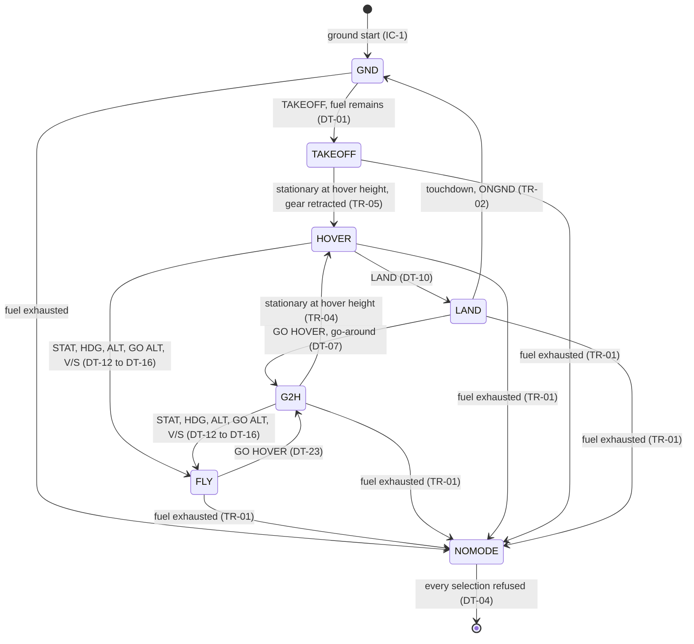
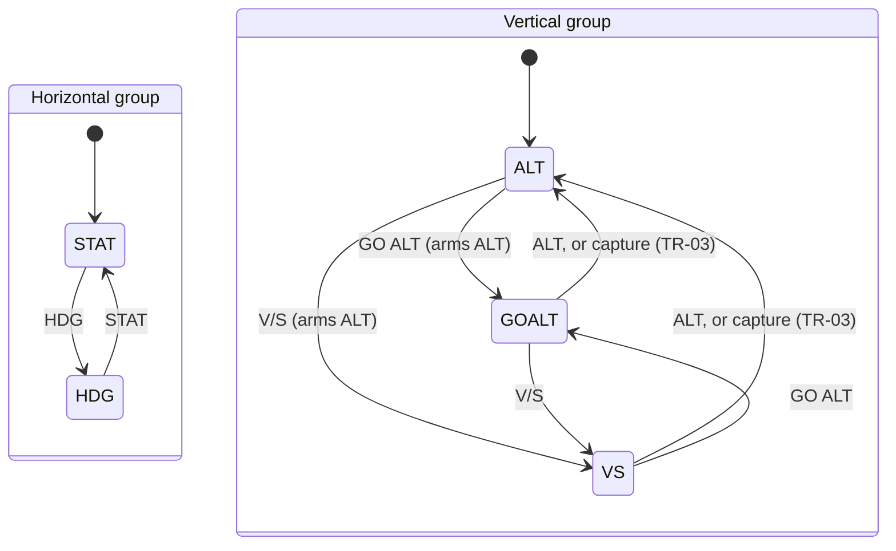

# Autoflight mode logic (AF_MODE_LOGIC)

**Status:** Draft by task C5 (draft of `specs/AF_MODE_LOGIC.md`). Written at branch c1_c2, commit 0b19af0 (D1 to D75). Not baselined; the owner questions C5-Q01 to C5-Q13 (`work/C5/issues.md`) are open, and the text follows the recommended answer of each.
**Binds:** every autoflight implementation (L2-AER-AF-010, D15). Any implementation pairs with any control-law design, because only the axis references cross to flight control (L1-AER-420).
**Not here:** the guidance laws, the shape of a capture and the gains (design, D4); the per-mode requirements (Phase 4, tasks M0 to M8); the selector ranges and unit conversion (FCP, `work/C8/L2_FCP.md`); the navigation quantities (NAV, `work/C6/L2_NAV.md`).

## 1. How to read this document

Row IDs (DT-nn decisions, TR-nn transitions, TG-nn target rules, HD-nn heading rules, GR-nn gear rules, IC-nn initial states) are cited by the L2 records and by the test procedures. A test that covers a row names it. SI units throughout; a crew unit appears only in a comment. Parameters are cited by ID.

**Terms** (GLOSSARY, with the refinements proposed in `work/C5/glossary_proposals.md`). *Active*: producing the references of its group. *Armed*: waiting to become active by a *capture* or a *handover*; produces no reference; armed by the mode that precedes it, never selected on its own. *Engaged* (autoflight): at least one mode is active. A *both-axes mode* is Go to hover, Hover, Takeoff or Land. A *mode selection* is one of the eight that the panel offers: STAT, HDG, ALT, GO ALT, V/S, GO HOVER, TAKEOFF, LAND (there is no Hover selection and no disengage selection, D71).

## 2. The catalogue

| Mode | Identifier | Group | Selection | Armed by | Becomes active by | Armed label | Active label |
| --- | --- | --- | --- | --- | --- | --- | --- |
| Stationary | STAT | Horizontal | STAT | — | Selection | — | STAT |
| Heading | HDG | Horizontal | HDG | — | Selection | — | HDG |
| Altitude hold | ALT | Vertical | ALT | Go to altitude, Vertical speed | Selection, or capture (TR-03) | ALT | ALT |
| Go to altitude | GOALT | Vertical | GO ALT | — | Selection | — | GO ALT |
| Vertical speed | VS | Vertical | V/S | — | Selection | — | V/S |
| Go to hover | G2H | Both axes | GO HOVER | — | Selection | — | GO HOVER |
| Hover | HOVER | Both axes | none | Go to hover, Takeoff | Handover (TR-04, TR-05) | HOVER | HOVER |
| Takeoff | TAKEOFF | Both axes | TAKEOFF | — | Selection | — | TAKEOFF |
| Land | LAND | Both axes | LAND | — | Selection | — | LAND |

One horizontal mode and one vertical mode are active at a time, independently (D56); a both-axes mode replaces both. The labels are the provisional labels of CONOPS §4.4, confirmed here; FCP shows them unchanged (L2-AER-FCP-320). The gear labels GEAR DOWN, GEAR UP and GEAR TRANSIT and the fuel alert labels are FCP's (L2-AER-FCP-340, -390 to -410, answer to IN-C8-07).

## 3. The mode state

AF keeps one data item, the *mode state*, with five fields. The set of values is fixed for every implementation (IN-C7-31).

| Field | Values |
| --- | --- |
| ENG | engaged, not engaged |
| AH, active horizontal mode | none, STAT, HDG |
| AV, active vertical mode | none, ALT, GOALT, VS |
| AB, active both-axes mode | none, G2H, HOVER, TAKEOFF, LAND |
| ARM, armed mode | none, ALT, HOVER |

**Invariants**, true at the end of every control frame:

| ID | Invariant |
| --- | --- |
| MS-1 | If AB is not none, then AH and AV are none (a both-axes mode replaces both groups) |
| MS-2 | ENG holds exactly when at least one of AH, AV, AB is not none |
| MS-3 | While ENG holds and AB is none, both AH and AV are not none (each group always has a mode while engaged; D56, A2-Q05) |
| MS-4 | ARM is ALT exactly when AV is GOALT or VS; ARM is HOVER exactly when AB is G2H or TAKEOFF; otherwise ARM is none |
| MS-5 | The axis references are the off value exactly when ENG does not hold (§12) |

## 4. The control frame

AF executes once per control frame, after FCP and NAV and before FC (DD-010). Inputs: from FCP the ordered mode selections of the frame, the SI target of each of the four selectors and the set of selectors accepted in the frame (ICD-FCP, IN-C8-01 to -04); from NAV the navigation quantities (ICD-NAV-AF); from DYN the gear state; from FU the fuel state. Order within AF:

| Step | Action |
| --- | --- |
| F1 | Read the inputs of the frame. |
| F2 | Evaluate the transitions TR-01 (fuel exhaustion) and TR-02 (end of Land), in that order. |
| F3 | Decide the mode selections, in the order given, each against the mode state that the previous one left (§6). Selector targets are those of the end of the frame's intake (DD-C8-01). |
| F4 | Evaluate the transitions TR-03 to TR-05, once. No chain follows from them. |
| F5 | Advance the references (§11, §12) and the gear command (§13). Give the off value if ENG does not hold. |
| F6 | Output: axis references to FC; annunciation content to FCP; mode state, targets and gear command to TM. |

A transition decided in a frame is annunciated in that frame's content (L2-AER-AF-810).

## 5. Conditions used by the rules

| Name | Meaning |
| --- | --- |
| ONGND | the gear state shows the vehicle on the ground |
| GEAR_EXT, GEAR_RET | the gear state shows the gear extended, retracted (in transit is neither) |
| FUEL_EXH | the fuel state indicates fuel exhaustion |
| STAT_HOV, stationary at the hover height | the height above the ground is within [P-AF-110] of [P-AF-210], the horizontal speed is at most [P-AF-170] and the magnitude of the vertical speed is at most [P-AF-090] |
| REACHED_HOV | not ONGND and the height above the ground is at least [P-AF-210] minus [P-AF-110] |
| d | the altitude still to go: the target altitude minus the altitude reference, signed |
| v_ref | the vertical speed reference, signed, positive up |
| level-off distance | v_ref squared divided by twice [P-AF-230] |
| CAPT, the capture condition of Altitude hold | see below |

**CAPT.** In Go to altitude the commanded vertical speed always points toward the target, so: CAPT holds when the magnitude of d is at most [P-AF-110], or when v_ref points toward the target and the magnitude of d is at most the level-off distance. In Vertical speed the commanded vertical speed is the selected vertical speed v_sel: CAPT holds at once when the product of v_sel and d is zero or negative (a selected altitude that is not ahead, TG-4), otherwise by the same two tests as Go to altitude. With v_ref pointing away from the target (a reversal) CAPT cannot hold until v_ref has crossed zero.

## 6. Decisions on mode selections (DT)

Each mode selection is decided as **accepted** or **refused**. A refused selection changes nothing: not the mode state, not the references, not the gear command. Selecting the mode that is already active in its group changes nothing, except GO ALT (DT-24). The state classes are read at the instant of the decision, from the running state of the frame.

| Class | Meaning |
| --- | --- |
| GND | ONGND and AB is not TAKEOFF: autoflight is not engaged |
| AIR0 | not ONGND and ENG does not hold (only after fuel exhaustion, or as a result of it) |
| TO, LD, HV, GH | AB is TAKEOFF, LAND, HOVER, G2H |
| FLY | AH and AV are both not none |

| ID | Class | Selection | Decision | State after (AH, AV, AB, ARM) |
| --- | --- | --- | --- | --- |
| DT-01 | GND, fuel remains | TAKEOFF | accepted | none, none, TAKEOFF, HOVER |
| DT-02 | GND, FUEL_EXH | TAKEOFF | refused | unchanged |
| DT-03 | GND | the seven others | refused | unchanged |
| DT-04 | AIR0 | each of the eight | refused | unchanged |
| DT-05 | TO | TAKEOFF | accepted, no change | unchanged |
| DT-06 | TO | the seven others | refused (Takeoff runs to its handover) | unchanged |
| DT-07 | LD | GO HOVER | accepted, a go-around (D70) | none, none, G2H, HOVER |
| DT-08 | LD | LAND | accepted, no change | unchanged |
| DT-09 | LD | the six others | refused | unchanged |
| DT-10 | HV | LAND | accepted | none, none, LAND, none |
| DT-11 | HV | GO HOVER | accepted, no change | unchanged |
| DT-12 | HV or GH | STAT | accepted; the vertical group takes ALT (TG-5) | STAT, ALT, none, none |
| DT-13 | HV or GH | HDG | accepted; the vertical group takes ALT | HDG, ALT, none, none |
| DT-14 | HV or GH | ALT | accepted; the horizontal group takes STAT (TG-6) | STAT, ALT, none, none |
| DT-15 | HV or GH | GO ALT | accepted; the horizontal group takes STAT | STAT, GOALT, none, ALT |
| DT-16 | HV or GH | V/S | accepted; the horizontal group takes STAT | STAT, VS, none, ALT |
| DT-17 | GH | GO HOVER | accepted, no change | unchanged |
| DT-18 | GH | LAND | refused (Land is engaged only from Hover) | unchanged |
| DT-19 | HV or GH | TAKEOFF | refused (airborne) | unchanged |
| DT-20 | FLY | STAT, HDG | accepted; replaces the horizontal mode only | the selected, AV, none, ARM |
| DT-21 | FLY | ALT | accepted; replaces the vertical mode only; clears the armed Altitude hold | AH, ALT, none, none |
| DT-22 | FLY | V/S | accepted; replaces the vertical mode only | AH, VS, none, ALT |
| DT-23 | FLY | GO HOVER | accepted; replaces both modes | none, none, G2H, HOVER |
| DT-24 | FLY | GO ALT | accepted; replaces the vertical mode only; a re-selection restarts at the standard vertical speed (TG-2) | AH, GOALT, none, ALT |
| DT-25 | FLY | TAKEOFF, LAND | refused | unchanged |

Reading notes. (1) A fuel-exhausted vehicle is always in GND or AIR0 after F2, so DT-02 to DT-04 cover every selection after exhaustion. (2) Takeoff and Land are *committed*: the crew cannot leave Takeoff before its handover to Hover, and can leave Land only by a go-around (DT-07), because both fly below the operating volume with the gear extended or in transit (C5-Q02). (3) After a go-around the gear stays commanded extended (GR-4), Hover engages with the gear extended (TR-04) and a new LAND descends at once (LD-1). (4) A selection of a group mode while the other group holds a mode of its own (FLY) is independent of that other mode (D56). (5) Selecting STAT while STAT is active, or HDG while HDG is active, and so on, leaves the state unchanged; it does not capture a new reference.

## 7. Engagement, arming and capture

| Mode | Active when | Arms | Active until |
| --- | --- | --- | --- |
| STAT | selection accepted (no engagement condition: stopping is part of the mode) | — | replaced by DT-12 to DT-25, or TR-01 |
| HDG | selection accepted | — | replaced by DT-20 (STAT), DT-23, or TR-01 |
| ALT | selection accepted (DT-21, DT-14), or capture TR-03 | — | replaced by DT-22, DT-24, DT-23, or TR-01 |
| GOALT | selection accepted | ALT | TR-03 (capture), replaced by DT-21, DT-22, DT-23, or TR-01 |
| VS | selection accepted | ALT | TR-03 (capture), replaced by DT-21, DT-24, DT-23, or TR-01 |
| G2H | selection accepted, airborne | HOVER | TR-04 (handover), replaced by DT-12 to DT-16, or TR-01 |
| HOVER | handover TR-04 or TR-05 | — | DT-10 (LAND), DT-12 to DT-16 (group selections), or TR-01 |
| TAKEOFF | selection accepted, on the ground, fuel remains | HOVER | TR-05 (handover), or TR-01 |
| LAND | selection accepted from HOVER | — | TR-02 (touchdown), DT-07 (go-around), or TR-01 |

D16 (arm first, engage when the conditions are met, the active mode manoeuvring meanwhile) applies to the two armed modes: while Altitude hold is armed, Go to altitude or Vertical speed flies the vehicle to the capture; while Hover is armed, Go to hover or Takeoff flies the vehicle to the handover.

## 8. Automatic transitions (TR)

| ID | Condition | Result | Notes |
| --- | --- | --- | --- |
| TR-01 | FUEL_EXH and ENG | AH, AV, AB, ARM all none; ENG not engaged | Evaluated first, in every frame. D68, C5-Q04. |
| TR-02 | AB is LAND and ONGND | AB none; ARM none; ENG not engaged | The frame in which the gear state first shows the contact. The off value (§12) is given in this frame. |
| TR-03 | AV is GOALT or VS, ARM is ALT, and CAPT | AV is ALT with the Altitude hold target of TG-4; ARM none | The armed Altitude hold becomes active. |
| TR-04 | AB is G2H, ARM is HOVER, and STAT_HOV | AB is HOVER; ARM none | The gear may be extended or in transit. |
| TR-05 | AB is TAKEOFF, ARM is HOVER, STAT_HOV and GEAR_RET | AB is HOVER; ARM none | Takeoff waits for the gear. |

At most one of TR-03 to TR-05 can apply to a state (their conditions need different modes). Their results are not re-evaluated in the frame.

**Disengagement.** A mode stops being active only by one of: replacement by an accepted selection (DT); a transition TR-01 to TR-05; nothing else. There is no crew selection that disengages autoflight: with no manual control (D49) a disengaged airborne vehicle would have nothing flying it. Autoflight is engaged by Takeoff or by the initial mode state (§14) and stays engaged until the end of Land or fuel exhaustion.

## 9. Targets (TG) and annunciation

**Targets in use.** The selected targets come from FCP (heading, horizontal speed, altitude, vertical speed). AF's own targets (the held altitude, the reference position, the hover altitude) are set by the rules below. The annunciation content lists each target in use with its quantity (IN-C8-05, -06). The hover altitude as a CG altitude at level attitude is [P-AF-210] plus half of [P-DYN-030].

| Mode | Targets in use, as quantity: value |
| --- | --- |
| STAT | none |
| HDG | heading: the selected heading; horizontal speed: the selected horizontal speed |
| ALT | altitude: the Altitude hold target |
| GOALT | altitude: the selected altitude; vertical speed: the vertical speed in use, signed toward the target |
| VS | vertical speed: the selected vertical speed; altitude: the selected altitude (the target of the armed Altitude hold) |
| G2H, HOVER | altitude: the hover altitude |
| TAKEOFF | altitude: the hover altitude; vertical speed: [P-AF-240] upward |
| LAND | vertical speed: [P-AF-240] downward |

The armed Altitude hold and the armed Hover take the target of the mode that arms them, so no extra entry is given for them.

| ID | Rule |
| --- | --- |
| TG-1 | A selector target is used only by the modes of the table above. A change of a used target retargets the active mode (the vehicle goes to the new target) and leaves the mode state unchanged. A change of a target that no active or armed mode uses has no effect; in particular, a new selected altitude does not move an active Altitude hold. |
| TG-2 | Go to altitude flies the standard vertical speed [P-AF-220]. A selected vertical speed accepted in the frame in which GO ALT is selected, or in a later frame while Go to altitude is active, replaces it from then on, taken as a magnitude (the direction is always toward the selected altitude); a selected vertical speed of zero is ignored. A re-selection of GO ALT restarts at [P-AF-220] (DT-24). |
| TG-3 | Vertical speed flies the selected vertical speed, signed, as it stands. Its change while Vertical speed is active retargets the rate. |
| TG-4 | The target of an Altitude hold that becomes active by capture is the selected altitude at the frame of the capture, except when the capture is immediate because the selected altitude is not ahead in Vertical speed: then it is the level-off altitude, the altitude reference plus v_ref times its magnitude divided by twice [P-AF-230]. The target of an Altitude hold selected directly (DT-14, DT-21) is the level-off altitude (C5-Q06). Once active, its target is fixed. |
| TG-5 | When a horizontal mode (STAT, HDG) is selected over Hover or Go to hover, the vertical group takes Altitude hold with the target of TG-4 (direct selection), so the vehicle holds the altitude it reaches. |
| TG-6 | When a vertical mode (ALT, GO ALT, V/S) is selected over Hover or Go to hover, the horizontal group takes Stationary, and the reference position is carried over (PR-1). |
| PR-1 | **Reference position.** When a mode that holds the horizontal position (STAT, G2H, HOVER, TAKEOFF, LAND, or HDG with a selected horizontal speed of zero, HD-4) becomes active from a mode that holds it, the reference position is carried over unchanged. |
| PR-2 | When such a mode becomes active from a mode that does not (HDG with a non-zero speed, or from the ground), the reference position is the *stopping position*: the horizontal position plus the horizontal velocity times its magnitude divided by twice the horizontal acceleration limit a_H (§11), so that the horizontal velocity reaches zero there (C5-Q05, #78). |
| PR-3 | The reference position of Takeoff is the ground position (PR-2 with zero velocity). Land holds the reference position of Hover (PR-1). |
| PR-4 | **Start of the hold.** The hold of the horizontal position starts at the frame in which a mode that holds it becomes active from a mode that does not (PR-2), or from autoflight not engaged. Handovers between holding modes (PR-1) do not restart it. The settling time [P-SYS-460] counts from this frame (L1-AER-460). |

**Annunciation content** (to FCP, each frame): the mode state (§3) as the identifiers of §2, each target in use with its quantity and SI value, and the gear position. FCP shows an empty label for a field with the value none. The content of the not-engaged state is the empty mode state with the gear position.

## 10. Heading behaviour (HD)

Pitch and roll references are zero in every state (D57). The heading reference changes only in HDG.

| ID | Mode | Heading reference | Direction of the horizontal velocity reference |
| --- | --- | --- | --- |
| HD-1 | HDG | goes to the selected heading through the smaller angle, at a rate of at most ω_max (§11); on an exact half turn, clockwise | with a non-zero selected speed, the heading reference |
| HD-2 | STAT, G2H, HOVER, TAKEOFF, LAND | constant: its value when the first of these modes became active (the heading reference in effect, or the NAV heading if there was none) | none: the horizontal velocity reference is zero |
| HD-3 | ALT, GOALT, VS | no influence: the heading reference is that of the horizontal group, or the constant one of a both-axes mode | none |
| HD-4 | HDG with a selected horizontal speed of zero | as HD-1: turns in place | none: holds the reference position (PR-1, PR-2); the vehicle is not moved by the wind (C5-Q07) |

On leaving HDG for a mode of HD-2, the heading reference stops where it is and its rate reference goes to zero. The heading reference of an airborne initial condition and of Takeoff is initialised from the NAV heading of the first frame in which AF provides references, valid or not (NAV gives the CV-260 yaw angle while invalid); nothing in the mode logic depends on the heading validity. AF does not use the track.

## 11. Guidance limits

| Limit | Value | Applies to |
| --- | --- | --- |
| Vertical acceleration a_V | [P-AF-230] | Every change of the vertical speed reference (ramp up, level-off, reversal) |
| Horizontal acceleration a_H | the square root of ([P-AF-200] squared minus [P-AF-230] squared) | The magnitude of the acceleration of the horizontal velocity reference, tangential and turning together |
| Heading rate ω_max | the lesser of [P-SYS-270] and a_H divided by the horizontal speed reference | The magnitude of the heading rate reference in HDG |
| Horizontal speed reference | zero to [P-SYS-230] | HDG |
| Vertical speed reference | minus [P-SYS-250] to [P-SYS-240] | GOALT, VS |

a_H is the part of [P-AF-200] that the vertical limit leaves, so that the acceleration of the translational velocity reference in three dimensions never exceeds [P-AF-200] (DD-C5-07). The heading-rate bound is the D72 Q1 bound: the horizontal speed times the heading rate stays within a_H, hence within [P-AF-200]; at [P-SYS-230] it gives about 3.62 deg/s, a little above [P-SYS-270] (3.6 deg/s), so [P-SYS-270] governs at the highest speed and the speed bound governs only when a tailwind or an overshoot lets the speed reference exceed the selected speed. When a speed change and a turn go together, the turn takes its share first and the speed change gets what is left of a_H (DD-C5-07).

## 12. Axis references and the off value

AF gives FC six axis references, one per degree of freedom, each made of a reference value, its rate and an indication of whether FC regulates the value (DD-C5-01; ICD-FC-AF is I1's with C4):

| Degree of freedom | Reference value | Rate | Value regulated |
| --- | --- | --- | --- |
| Horizontal north, east (frame L) | reference position | horizontal velocity reference | in holds; not while HDG moves at a non-zero speed |
| Vertical | altitude reference (CG altitude) | vertical speed reference | in ALT, HOVER and the holds inside G2H and TAKEOFF; not while climbing or descending at a rate (GOALT, VS, the climb of TAKEOFF, the descent of LAND) |
| Heading | heading reference | heading rate reference | always |
| Pitch, roll | zero | zero | always |

The **off value** is a single indication that replaces all six references: autoflight is not engaged. It is given in the frame in which ENG ceases to hold (TR-01, TR-02) and until a Takeoff or an initial mode state engages it. FC sets the effector activation state off exactly while the references are off (IN-C3-26, IN-C3-30; L1-AER-930), so the effectors go off within one control frame of the landing contact (the AF share of [P-SYS-480]). The off value carries no mode information (L1-AER-420).

## 13. Landing gear and effectors

The *landing gear command* is extend or retract. It is held between changes.

| ID | Rule |
| --- | --- |
| GR-1 | At the first frame the command is the gear position of the initial condition, as the gear state shows it. |
| GR-2 | A retraction is commanded only by Takeoff, at the first frame with REACHED_HOV, and never while ONGND (L1-AER-910: a retraction on the ground would drop the body). |
| GR-3 | Land commands extension at the frame in which it becomes active. |
| GR-4 | No other mode, transition or selection changes the command. After a go-around (DT-07) the gear stays commanded extended. |
| LD-1 | Land flies the Hover altitude and the reference position while the gear is not GEAR_EXT. When GEAR_EXT, it commands the downward vertical speed [P-AF-240] with the rate-only vertical reference and keeps it until the off value is given (TR-02), so that FC commands no more than the weight at the contact (IN-C1-43). |
| TO-1 | Takeoff, from the ground: ENG begins and the references leave the off value in the frame of the selection (the effectors go on); the vertical reference ramps to [P-AF-240] upward (rate only), the horizontal reference holds the ground position, the heading reference is constant. At the first frame with REACHED_HOV the retraction is commanded and the vertical reference ramps to zero over the altitude hold of the hover altitude. TR-05 follows. |

## 14. Fuel exhaustion and initial states

**Fuel exhaustion (D68, C5-Q04).** At FUEL_EXH the effectors stop and the vehicle falls; there is no recovery. TR-01 clears the mode state in the frame in which the fuel state shows exhaustion, the references take the off value, every later mode selection is refused (DT-02 to DT-04), and the annunciation content has the empty mode state; FCP shows FUEL EXHAUSTED (L2-AER-FCP-400). The landing gear command is held. LOW FUEL changes nothing in AF.

**Initial mode state** (L1-AER-660, TT-610, #60). A run starts on the ground with no mode active (IC-1). A test run or a credibility check may start airborne (D73).

| ID | Initial state | Valid |
| --- | --- | --- |
| IC-1 | On the ground (gear state shows ONGND): no mode active, not engaged | yes, the only valid state on the ground |
| IC-2 | Airborne: AH in {STAT, HDG}, AV in {ALT, GOALT, VS}, ARM per MS-4, ENG engaged | yes |
| IC-3 | Airborne: AB in {G2H, HOVER}, ARM per MS-4, ENG engaged | yes |
| IC-4 | Airborne with fuel exhausted: no mode active | yes (free-fall checks) |
| IC-5 | Airborne with fuel remaining and no mode active | no: initial-condition error |
| IC-6 | AB is TAKEOFF or LAND at the start | no: initial-condition error |
| IC-7 | Any mode active at a ground start | no: initial-condition error |

For an airborne start the references start from the NAV quantities of the first frame (the horizontal position and velocity, the altitude, the heading); the Altitude hold target is the level-off altitude (TG-4), the Stationary reference position the stopping position (PR-2); the selected targets are the initial selector values that FCP gives (IN-C8-08).

## 15. State diagrams

FLY holds one horizontal and one vertical mode:

The two groups are independent in FLY; the entry from a both-axes mode sets STAT or ALT in the group that was not selected (TG-5, TG-6).

## 16. Check against the ConOps scenarios

| Scenario | Sequence in the ConOps | Rows that give it |
| --- | --- | --- |
| SC-020 | HDG·ALT, GO ALT → HDG·GO ALT (ALT armed), VS_SEL (retarget), capture → HDG·ALT | DT-24, TG-1, TG-2, TR-03 |
| SC-040 | STAT·ALT, V/S → STAT·V/S (ALT armed), capture → STAT·ALT | DT-22, TR-03 |
| SC-050 | targets change in HDG·ALT; GO ALT; V/S during the climb (ALT stays armed on the same altitude); ALT before the capture holds the altitude reached | TG-1, DT-24, DT-22, DT-21 with TG-4 |
| SC-060, SC-120 | STAT·ALT, HDG → HDG·ALT; at zero speed the heading change turns in place | DT-20, HD-1, HD-4 |
| SC-090 | HDG·ALT, STAT → STAT·ALT, reference position held | DT-20, PR-2 |
| SC-100 | HDG·ALT, GO HOVER → GO HOVER (HOVER armed), then HOVER; from below as a go-around | DT-23, TR-04, DT-07 |
| SC-130 | none, TAKEOFF → TAKEOFF (HOVER armed), HOVER, LAND, none; zero fuel: TAKEOFF refused; GO HOVER in LAND; second takeoff | DT-01, TR-05, DT-10, TR-02, DT-02, DT-07 |
| SC-110 | legs 0 to 11: TAKEOFF, HOVER; HDG, GO ALT (leaves Hover); GO ALT, V/S; GO HOVER; LAND; TAKEOFF; STAT, V/S (leaves Hover); HDG at zero speed; STAT; exhaustion (no mode) | DT-01, TR-05, DT-13, DT-15, DT-23, TR-04, DT-10, TR-02, DT-12, DT-16, HD-4, TR-01 |

Where the ConOps left a point to C5: the reference position is the stopping position (SC-090, PR-2); ALT in step 5 of SC-050 holds the level-off altitude (TG-4); Vertical speed with a selected altitude behind or a zero rate becomes Altitude hold at once (SC-040, CAPT); Heading at zero speed holds the position (SC-120, HD-4); after Land no mode is active and nothing is annunciated but the gear (SC-130, TR-02); after fuel exhaustion no mode is active (SC-110 leg 11, TR-01); the gear labels are FCP's (SC-130); how the crew leaves Hover is by a group selection (DT-12 to DT-16).

## 17. Deferred to Phase 4

The per-mode sections M0 (Stationary, the pattern), M2, M3, M5, M8 (Go to hover, Hover, Takeoff and Land) refine, below the L2 records, for each mode: the shape of the capture and the level-off profile; the stopping profile; the heading-rate and speed-change shaping; the track tolerance in Heading ([P-AF-140]); the split of each tolerance [P-AF-090] to [P-AF-130] between the AF reference and the FC tracking (as [P-AF-160] and [P-FC-010] split [P-SYS-450]); and the test sequences. They may not change a row of this document without a change request to it.
